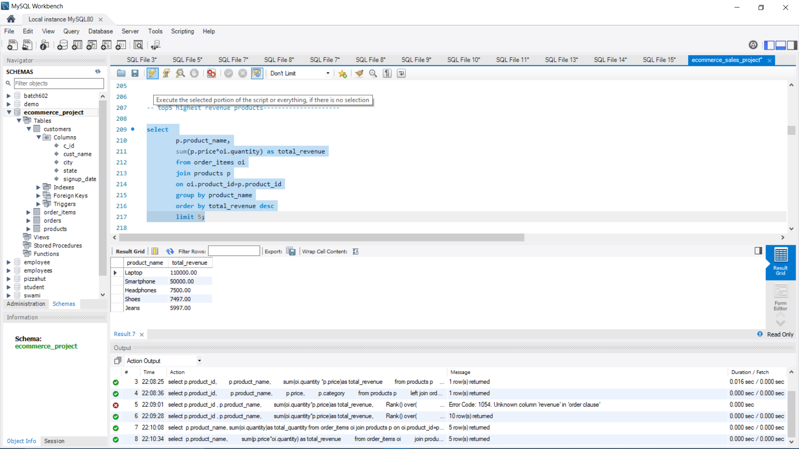
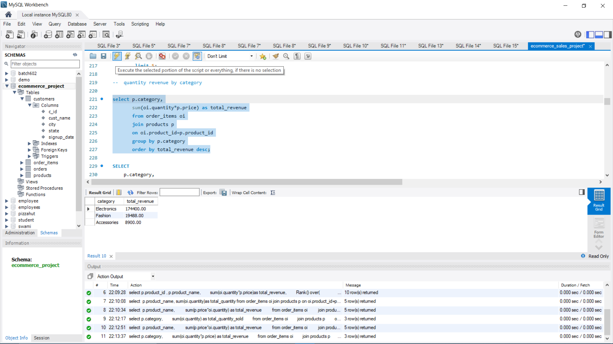
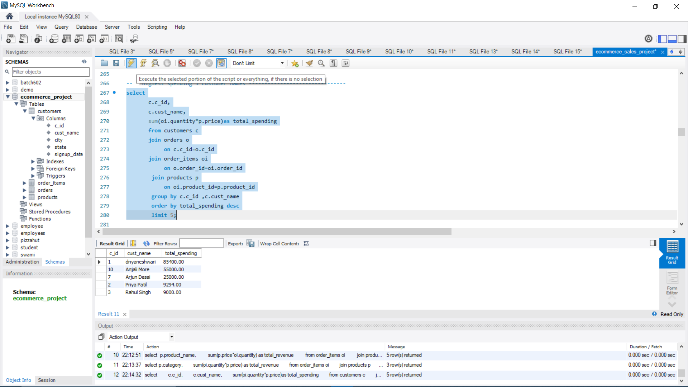
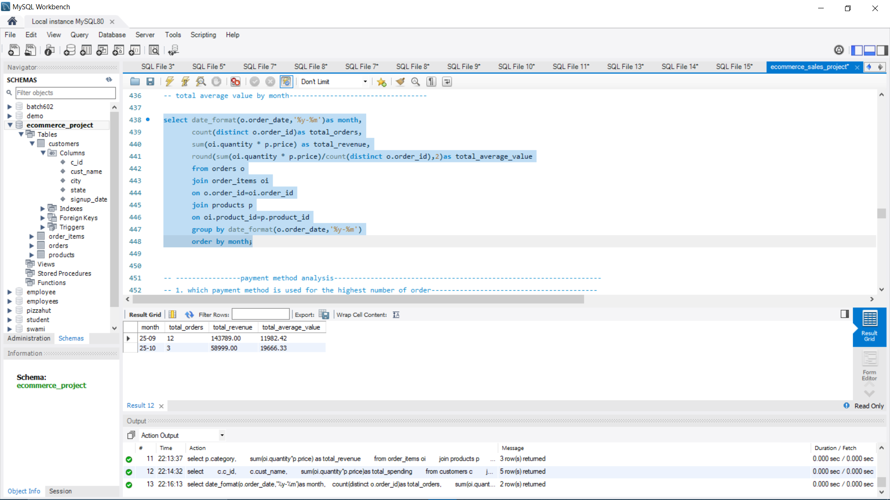

# E-commerce Sales Analysis using MySQL

## 📌 Project Overview

This project analyzes e-commerce sales data using **MySQL** to understand sales performance, customer behavior, product performance, order status, payment methods, and revenue trends.

The project uses SQL queries to extract useful business insights from customer, product, order, and order-item data.

## 🎯 Objectives

- Analyze overall sales performance
- Identify top-performing products and categories
- Understand customer spending behavior
- Analyze monthly sales trends
- Analyze order status and payment methods
- Analyze sales by city and state
- Calculate important business KPIs
- Generate business insights using SQL

## 🛠️ Tools & Technologies

- **MySQL**
- **MySQL Workbench**
- **SQL**

## 🗄️ Database Tables

The project contains four main tables:

- `customers` — customer information
- `products` — product details and prices
- `orders` — order information and status
- `order_items` — products and quantities included in each order

## 📊 SQL Analysis Performed

The project includes analysis of:

- Overall revenue and sales KPIs
- Total orders and units sold
- Average Order Value (AOV)
- Product-wise sales
- Category-wise revenue
- Customer spending
- Order status
- Monthly sales trends
- Payment methods
- Sales by city
- Sales by state
- Top customers
- Top products
- Products below average revenue
- Product revenue ranking using `RANK()`
- Revenue contribution by category

## 📈 Key Results

| Metric | Result |
|---|---:|
| Total Orders | 15 |
| Total Customers | 10 |
| Total Units Sold | 29 |
| Total Revenue | ₹202,788 |
| Average Order Value | ₹13,519.20 |
| Delivered Orders | 9 |
| Delivered Order Value | ₹182,691 |
| Top Revenue Product | Laptop |
| Top Product Revenue | ₹110,000 |
| Top Category | Electronics |
| Top Category Revenue | ₹174,400 |
| Top Customer | Amit Sharma |
| Top Customer Spending | ₹85,400 |

## 💡 Business Insights

- **Electronics** was the highest-revenue category, generating ₹174,400.
- **Laptop** was the highest-revenue product, generating ₹110,000.
- **T-Shirt** had the highest quantity sold, with 6 units.
- **Amit Sharma** was the highest-spending customer, with ₹85,400 in spending.
- **Pune** generated the highest city-level revenue at ₹88,900.
- Delivered orders represented 9 of the 15 total orders.

## 🧠 SQL Concepts Used

- SELECT
- WHERE
- GROUP BY
- ORDER BY
- HAVING
- JOIN
- DISTINCT
- COUNT()
- SUM()
- AVG()
- ROUND()
- DATE_FORMAT()
- Subqueries
- Aggregate functions
- Window functions
- `RANK() OVER()`

## 📂 Project Structure

```text
ecommerce-sales-analysis-sql/
│
├── sql/
│   └── ecommerce_sales_analysis.sql
│
└── README.md
```

## 📸 Project Screenshots

### Overall Business KPIs


### Top Products


### Category Revenue


### Customer Spending


### Monthly Sales



## 👩‍💻 Author

**Masulkar Dnyaneshwari Subhash**

Computer Engineering Student | Aspiring Data Analyst

Skills: SQL | Python | Excel | Power BI | Data Analytics
